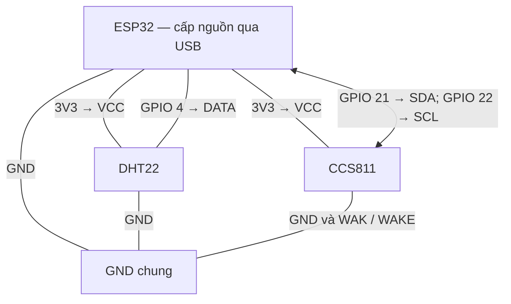
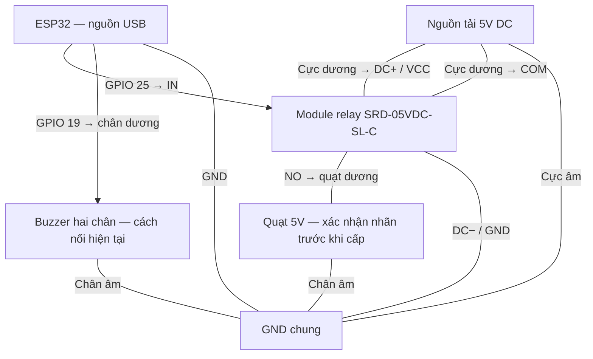

# Sơ đồ lắp mạch trạm giám sát không khí

Sơ đồ thô theo chân trong firmware `firmware/esp32_air_node/esp32_air_node.ino` và cách nối còi được mô tả. Relay dùng **GPIO 25**, buzzer dùng **GPIO 19**. Các đường nguồn gợi ý bên dưới cần đối chiếu lại với module thực tế; đây chưa phải bản kiểm chứng toàn bộ dây trên breadboard.

## 1. Nguồn và tín hiệu cảm biến

ESP32 được cấp nguồn qua USB. Chân 3V3 cấp cho hai cảm biến theo phương án bên dưới. Mọi ký hiệu GND trong tài liệu đều là cùng một mạng điện.



DHT22 rời: kéo DATA lên 3V3 bằng điện trở 4,7–10 kΩ nếu module chưa có sẵn. Đối chiếu định mức module CCS811 trước khi cấp nguồn.

## 2. Nguồn và tín hiệu relay, quạt, còi

Sơ đồ nguồn tải dưới đây là **phương án cấp 5V riêng cho module relay và quạt**, áp dụng khi xác nhận quạt có định mức 5V. Không nối cực +5V ngoài vào đường 3V3 hoặc GPIO ESP32. Nối chung cực âm nguồn tải với GND ESP32 trong phương án này.



Relay: chân **NC không nối**. Còi được vẽ đúng cách nối trực tiếp đã mô tả, chưa xác nhận điện áp/dòng định mức và khả năng cấp dòng phù hợp của GPIO.

## Bảng đấu nối

| Thành phần | Chân linh kiện | Nối đến | Ghi chú |
|---|---|---|---|
| DHT22 | DATA / OUT | ESP32 GPIO 4 | Theo firmware |
| DHT22 | VCC | 3V3 | Phương án cấp nguồn đề xuất |
| DHT22 | GND | GND chung | |
| CCS811 | SDA | ESP32 GPIO 21 | I²C |
| CCS811 | SCL | ESP32 GPIO 22 | I²C |
| CCS811 | VCC | 3V3 | Đối chiếu thông số module |
| CCS811 | GND | GND chung | |
| CCS811 | WAK / WAKE | GND | Giữ cảm biến sẵn sàng giao tiếp |
| Module relay | IN | ESP32 GPIO 25 | Firmware đặt HIGH để bật; chọn chế độ kích tương ứng |
| Module relay | DC+ / VCC | Nguồn +5V | Kiểm tra nhãn chân trên module |
| Module relay | DC− / GND | GND chung | Kiểm tra nhãn chân trên module |
| Relay | COM | Cực dương nguồn quạt | Dùng +5V nếu nhãn quạt xác nhận định mức 5V |
| Relay | NO | Cực dương quạt | Mặc định hở khi relay chưa kích |
| Relay | NC | Không nối | |
| Quạt | Cực âm | Cực âm nguồn quạt / GND | Chưa xác định cực tính theo dây đen và xám |
| Buzzer | Chân dương, ký hiệu (+) | ESP32 GPIO 19 | Cách nối hiện tại do người lắp mô tả |
| Buzzer | Chân âm | GND chung | Điện áp và dòng định mức chưa xác định |
| ESP32 | USB | Nguồn USB | Không ghép tùy ý đường +5V ngoài với đường nguồn USB |

Đường cấp điện cho quạt: **nguồn (+) → COM → NO → quạt (+); quạt (−) → nguồn (−)**.

## Lưu ý đối chiếu

- Xác định cực quạt bằng nhãn hoặc điểm hàn, không suy ra chỉ từ màu dây đen/xám.
- Sơ đồ thể hiện còi nối trực tiếp như mạch hiện tại, không khẳng định cách cấp dòng này phù hợp. Cần biết thông số còi; nếu vượt khả năng GPIO, dùng tầng kích transistor và nguồn đúng định mức.
- Module relay cần nhận được logic 3,3V nếu nối IN trực tiếp với ESP32. Không đưa 5V vào GPIO.
- DHT22 rời cần điện trở kéo DATA lên 3V3, thường 4,7–10 kΩ; module có sẵn điện trở thì không cần thêm.
- GPIO 16 và 17 có khai báo điều khiển LED trong firmware, nhưng không đưa LED vào sơ đồ này vì chưa xác nhận lắp thực tế.
- Ngắt nguồn trước khi thay đổi dây. Sơ đồ dùng tên chân; vị trí vật lý phải xem chữ in trên module.

## Đưa sơ đồ lên GitHub

Lưu file này thành `hardware/so_do_lap_mach.md`. GitHub có thể hiển thị trực tiếp khối Mermaid phía trên.

Thêm liên kết vào `README.md` ở thư mục gốc nếu cần:

```markdown
[Sơ đồ lắp mạch](hardware/so_do_lap_mach.md)
```
